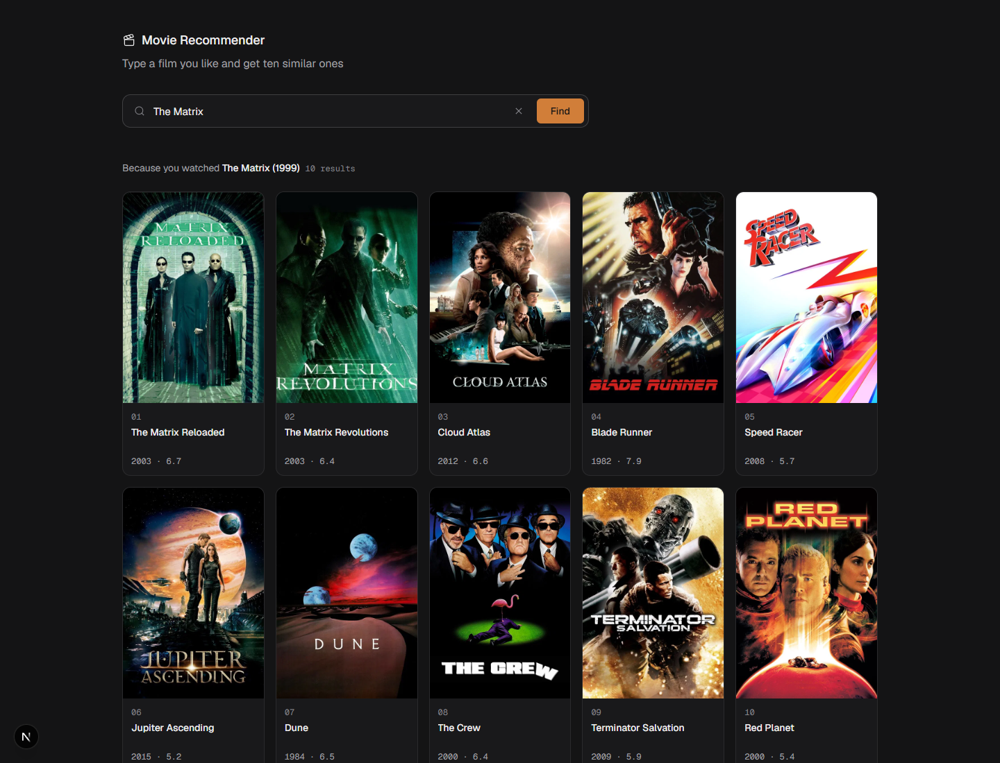
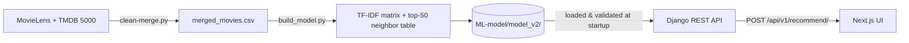

# Movie Recommender

[](https://github.com/abdelillah01/Movie-Recommender/actions/workflows/ci.yml)


Type a film you like, get ten similar ones. A content-based recommender (TF-IDF + cosine similarity over genres, keywords, cast and director) served by a Django REST API and a Next.js UI, with an offline evaluation harness that compares it against popularity, collaborative-filtering and embedding baselines.



## Results

Evaluated on 3,536 films with MovieLens ratings; 270 held-out test users × 5 seeds each, 95% CIs over users. Full table, methodology and caveats: [`evaluation/results.md`](evaluation/results.md).

| Model | NDCG@10 (95% CI) | Notes |
|---|---|---|
| Popularity: most liked | **0.410** ± 0.035 | ignores the query entirely |
| Item-item CF (train users only) | **0.233** ± 0.020 | out-of-sample: never sees the test users |
| Production: TF-IDF metadata + rating rerank | **0.080** ± 0.011 | what the API serves |
| TF-IDF metadata | 0.075 ± 0.010 | |
| Sentence embeddings (MiniLM) | 0.072 ± 0.009 | |
| TF-IDF + overview / tuned / SVD | 0.066 – 0.069 | all within noise of each other |

**What this does and doesn't say**

- All content-based variants (plain, +overview, tuned, SVD, embeddings, rerank) are statistically indistinguishable. Adding plot text or swapping in embeddings did **not** measurably help.
- Collaborative filtering clearly beats content similarity, and a hybrid doesn't beat CF alone.
- A query-ignoring *"most liked"* list beats everything. That is a property of the protocol: held-out "also liked" films are dominated by globally popular titles, so the metric rewards popularity. It does not measure the thing the product promises, *films that feel like the one you typed*. Treat these numbers as "agreement with what users liked", not "quality of similarity".
- An earlier version of this harness reported CF at 0.33 vs content at 0.07 and "content beats popularity". Both were artifacts of CF being built from the test users' own ratings and of a weak mean-rating baseline. The split is now by user, and the old numbers should not be cited.

## How it works



1. **Data** (`ML-model/notebooks/clean-merge.py`): joins MovieLens `movies`/`links`/`ratings` with TMDB 5000 `movies`/`credits`, giving 3,536 films with genres, keywords, top-5 cast, director, overview, TMDB id, `vote_average`. `scripts/fetch_posters.py` adds a `poster_path` per film.
2. **Model** (`ML-model/notebooks/build_model.py`): TF-IDF (10k features, English stop words) over genres + keywords + cast + director. It also precomputes each film's 50 nearest neighbors, because the catalog is static.
3. **API** (`backend/recommender_app/`): resolves the typed title, looks up the film's 50 neighbors, re-ranks them by `similarity × vote_average^0.3`, and attaches poster URLs from an in-memory cache built at startup (no per-request TMDB calls).
4. **UI** (`frontend/`): search box, skeleton loaders, poster grid, and distinct messages for "not found" / "backend down" / "rate limited".

### Title matching

Catalog titles are MovieLens-style (`Matrix, The (1999)`, `Seven (a.k.a. Se7en) (1995)`), but people type `The Matrix` or `se7en`. Matching goes: exact title → normalized title or alias (year dropped, trailing article restored, accents folded; a year in the query disambiguates remakes) → fuzzy (`difflib`, cutoff 0.75). The response includes `query` **only** when a fuzzy correction happened, so the UI can say "no exact match for X, showing Y".

### Model artifacts

Everything the API needs lives in `ML-model/model_v2/` and is produced by one command, so the pieces cannot drift apart: `vectorizer.joblib`, `tfidf_matrix.npz`, `movies.csv`, `neighbor_table.npy`, `model_meta.json`. On startup the API **refuses to start** (and `/recommend/` returns 503) if the scikit-learn version differs from the one that built the model, or if the matrix, movie table and neighbor table disagree on size.

## Quickstart

Requires Python 3.11+ and Node 20+. The trained model is committed, so you don't need to retrain.

```bash
git clone https://github.com/abdelillah01/Movie-Recommender.git
cd Movie-Recommender

# Backend
python -m venv .venv
source .venv/bin/activate          # Windows: .venv\Scripts\activate
pip install -r backend/requirements.txt
cp backend/.env.example backend/.env   # Windows: copy backend\.env.example backend\.env
cd backend && python manage.py runserver   # http://127.0.0.1:8000
```

```bash
# Frontend (new terminal)
cd frontend
cp .env.example .env.local         # Windows: copy .env.example .env.local
npm install
npm run dev                         # http://localhost:3000
```

`backend/.env` needs a `SECRET_KEY` (see the comment in `.env.example`). `TMDB_API_KEY` is optional: only the poster prefetch script and a last-resort live fallback use it.

### API

Interactive docs at <http://127.0.0.1:8000/api/docs/>.

```bash
curl -X POST http://127.0.0.1:8000/api/v1/recommend/ \
  -H "Content-Type: application/json" \
  -d '{"title": "The Matrix", "n": 3}'
```

```json
{
  "matched": "Matrix, The (1999)",
  "recommendations": [
    {"title": "Matrix Reloaded, The (2003)", "poster": "https://image.tmdb.org/t/p/w500/8xEVAe84zlL9rkfYT6dZXero4KK.jpg", "release_date": "2003-05-15", "vote_average": 6.7, "tmdb_id": 604}
  ]
}
```

| Status | Meaning |
|---|---|
| 200 | `matched` is the resolved film; `query` is present only if the input was fuzzily corrected |
| 400 | invalid body (`title` missing/too long, `n` outside 1–50) |
| 404 | no film in the catalog is close enough |
| 429 | throttled (60 requests/min per IP) |
| 503 | model artifacts missing or built with a different scikit-learn |

### Tests and linting

```bash
cd backend && pytest                # 33 tests, incl. a no-mocks check against the real catalog
ruff check backend/ && black --check backend/
cd frontend && npm run lint && npx tsc --noEmit
```

### Rebuilding the model and the evaluation

```bash
python scripts/download_data.py     # MovieLens (ratings etc.); TMDB 5000 CSVs are a manual Kaggle download, see the script output
python ML-model/notebooks/clean-merge.py   # only if you want to regenerate merged_movies.csv (drops poster_path; re-run scripts/fetch_posters.py with a TMDB key)
python ML-model/notebooks/build_model.py   # rebuilds ML-model/model_v2/
pip install sentence-transformers          # optional: adds the embeddings row to the evaluation
python evaluation/evaluate.py              # rewrites evaluation/results.md (use --no-embeddings to skip M5)
```

## Project layout

```
ML-model/
  data/{raw,processed}/        source CSVs and merged_movies.csv
  notebooks/                   clean-merge.py (data), build_model.py (model)
  recommender/                 data_loader.py, model_builder.py
  model_v2/                    committed model artifacts (see above)
backend/
  backend/                     Django settings / urls
  recommender_app/             utils.py (model + matching), views.py (DRF), tests.py
frontend/
  app/page.tsx                 page and state
  components/                  SearchBar, MovieCard, LoadingSkeleton, BackgroundFX
  lib/api.ts                   typed API client + error classification
evaluation/                    evaluate.py, results.md
scripts/                       download_data.py, fetch_posters.py
```

## Design decisions and trade-offs

- **Precomputed neighbors instead of request-time similarity.** The catalog is fixed, so the top-50 neighbors are computed at build time and a request is a table lookup plus a 50-item rerank. This only works because the catalog is static; adding films means rebuilding.
- **Posters as a column, not an API call.** Fetching a poster per result put up to ~20 sequential TMDB calls on every request. Posters are now prefetched into the dataset (the commit that removed the fan-out reports p95 ≈ 3 s → ≈ 11 ms; see `703c4d6`), with a cached live fallback for misses.
- **Content-based, not collaborative, in production, even though CF scores higher.** There are no users to learn from, and CF needs a co-rating history for the query film; content similarity works for any film in the catalog. CF is kept in the harness as the honest comparison, not the product.
- **Metadata-only TF-IDF.** Adding plot text did not help beyond noise, so the simpler feature set is used. Embeddings were tested and also did not beat it measurably, and would add a PyTorch dependency for no measured gain.
- **Rating rerank over the top-50 only.** It nudges well-rated films up without letting a high rating pull in unrelated ones. Its measured effect (+6.6%) is within noise, so it is a product choice (fewer obscure results), not a demonstrated accuracy gain.
- **Fail loudly on artifact mismatch.** A silently wrong model is worse than a 503.
- **Django + DRF for one endpoint.** Serializers give request validation and an OpenAPI schema for free; migrating to something lighter buys little.

## Limitations and what I'd do next

- The catalog is small (MovieLens small ∩ TMDB 5000, 3,536 films) and its newest film is from August 2016, so recent films such as *Parasite* return 404.
- The evaluation metric rewards popularity (see Results). Next: popularity-corrected metrics and a small human-judged set of "does this feel similar?" for content models.
- Franchise results dominate: querying *Toy Story* returns its sequels, which is correct but makes the list look better than the model is. No franchise de-duplication yet.
- The API doesn't return genres or a similarity score, so the UI can't explain *why* a film was recommended.
- No frontend tests; CI runs lint and type-check only.
- The `models.py`/SQLite database is unused scaffolding.

## Data and credits

- [MovieLens `ml-latest-small`](https://grouplens.org/datasets/movielens/latest/) (GroupLens Research): ratings, titles, links.
- [TMDB 5000 Movie Dataset](https://www.kaggle.com/datasets/tmdb/tmdb-movie-metadata): cast, crew, keywords, overviews.
- Posters and `vote_average` © [TMDB](https://www.themoviedb.org/). This product uses the TMDB API but is not endorsed or certified by TMDB.

MIT licensed. See [LICENSE](LICENSE).
