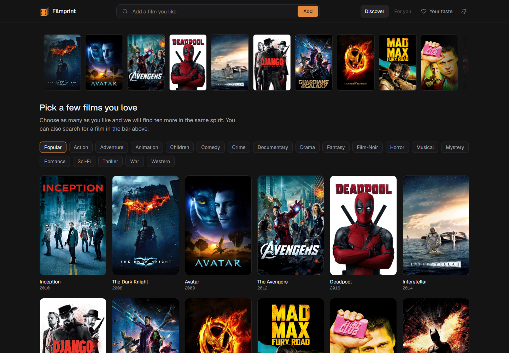
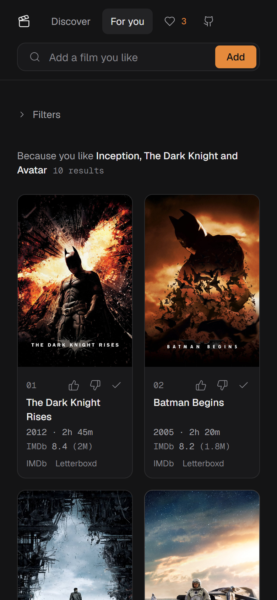
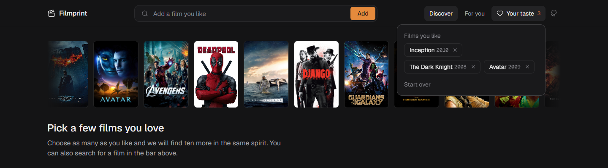
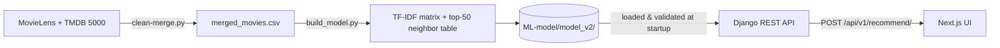

<p align="center"></p>

# Filmprint - movie recommendation system

[](https://github.com/abdelillah01/filmprint/actions/workflows/ci.yml)


Tell it a few films you like (and ones you don't) and get ten to watch next. A content-based recommender (TF-IDF + cosine similarity over genres, keywords, cast and director) that builds a taste profile from your picks, served by a Django REST API and a Next.js UI, with an offline evaluation harness that compares it against popularity, collaborative-filtering and embedding baselines and measures what each extra input is worth.



<table>
  <tr>
    <td width="62%" valign="top">
      
      <br><sub><b>For you</b>: ten picks with IMDb ratings and links, and a stats sidebar comparing them to your liked films.</sub>
    </td>
    <td width="38%" valign="top" rowspan="2">
      
      <br><sub><b>On a phone</b>: the search drops to its own row and the stats sit below the posters.</sub>
    </td>
  </tr>
  <tr>
    <td valign="top">
      
      <br><sub><b>Your taste</b>: every film you liked, disliked or marked seen, with Start over.</sub>
    </td>
  </tr>
</table>

## Results

**Short version:** content similarity works as a signal but is a modest one. Every content variant I tried scores about the same, and collaborative filtering beats them all. A plain "most popular" list wins this benchmark, mostly because of how the benchmark defines success.

Held-out evaluation on 3,536 films: 270 test users × 5 queries each, MovieLens ratings, 95% CIs over users. Full table, methodology and limitations: [`evaluation/results.md`](evaluation/results.md).

| Model | NDCG@10 (±95% CI) |
|---|---|
| Popularity: most liked (ignores the query) | 0.410 ± 0.035 |
| Item-item collaborative filtering (trained on other users) | 0.233 ± 0.020 |
| **Production: TF-IDF metadata + rating rerank** | **0.080 ± 0.011** |
| TF-IDF metadata / embeddings / +overview / tuned / SVD | 0.066 – 0.075, within noise of each other |

- **Content variants are tied.** Adding plot text, tuning, SVD or sentence embeddings did not measurably help, so the simplest feature set ships.
- **Popularity wins by construction.** Films users "also liked" are mostly popular ones, so the metric rewards popularity. It does not measure the product's real promise, *films that feel like the one you typed*; read the scores as agreement with user taste, not similarity quality.
- **More input helps, measurably.** On the same held-out users, a profile built from 3 liked films scores +62% NDCG over a single film, and 5 films another +29% (both beyond noise). Marking dislikes did not help measurably; hiding already-watched films helped a little. See the *Personalization lift* section of `evaluation/results.md`.
- **Corrected numbers.** An earlier harness version overstated CF and claimed content beat popularity, because CF saw the test users' ratings and the baseline was weak. The split is now by user.

## How it works



1. **Data** (`ML-model/notebooks/clean-merge.py`): joins MovieLens `movies`/`links`/`ratings` with TMDB 5000 `movies`/`credits`, giving 3,536 films with genres, keywords, top-5 cast, director, overview, TMDB id, `vote_average`. `scripts/fetch_posters.py` adds a `poster_path` per film.
2. **Model** (`ML-model/notebooks/build_model.py`): TF-IDF (10k features, English stop words) over genres + keywords + cast + director. It also precomputes each film's 50 nearest neighbors, because the catalog is static.
3. **API** (`backend/recommender_app/`): resolves the typed titles and builds a **taste profile**: the average TF-IDF vector of the liked films, pushed away from the disliked ones (`profile.py`). It scores every film against it, drops anything liked/disliked/marked seen or failing the filters, then re-ranks the best 50 by `similarity × vote_average^0.3`. A single film with no filters takes a fast path through a precomputed neighbor table (verified to return the same list). Posters come from an in-memory cache built at startup (no per-request TMDB calls).
4. **UI** (`frontend/`): a sticky **navbar** (brand, autocomplete search, **Discover** / **For you** pages, a **Your taste** menu listing your liked / not-for-me / hidden films with Start over, and a GitHub link). **Discover** is the cold-start page: a slow strip of popular posters plus a pick-your-films grid with genre quick-picks, always reachable from the navbar. Search adds films to a taste profile, 👍 / 👎 / ✓ on every result to refine it, genre / year / rating filters, a poster grid, and distinct messages for "not found" / "backend down" / "rate limited". The profile is kept in your browser (`localStorage`) and only sent to the API as part of a request.

### Title matching

Catalog titles are MovieLens-style (`Matrix, The (1999)`, `Seven (a.k.a. Se7en) (1995)`), but people type `The Matrix` or `se7en`. Matching goes: exact title → normalized title or alias (year dropped, trailing article restored, accents folded; a year in the query disambiguates remakes) → fuzzy (`difflib`, cutoff 0.75). The response includes `query` **only** when a fuzzy correction happened, so the UI can say "no exact match for X, showing Y".

### Model artifacts

Everything the API needs lives in `ML-model/model_v2/` and is produced by one command, so the pieces cannot drift apart: `vectorizer.joblib`, `tfidf_matrix.npz`, `movies.csv`, `neighbor_table.npy`, `model_meta.json`. On startup the API **refuses to start** (and `/recommend/` returns 503) if the scikit-learn version differs from the one that built the model, or if the matrix, movie table and neighbor table disagree on size.

## Quickstart

Requires Python 3.11+ and Node 20+. The trained model is committed, so you don't need to retrain.

```bash
git clone https://github.com/abdelillah01/filmprint.git
cd filmprint

# Backend
python -m venv .venv
source .venv/bin/activate          # Windows: .venv\Scripts\activate
pip install -r backend/requirements.txt
cp backend/.env.example backend/.env   # Windows: copy backend\.env.example backend\.env
cd backend && python manage.py runserver   # http://127.0.0.1:8000
```

```bash
# Frontend (new terminal)
cd frontend
cp .env.example .env.local         # Windows: copy .env.example .env.local
npm install
npm run dev                         # http://localhost:3000
```

Open <http://localhost:3000>. You land on **Discover**: pick a few posters (switch genre with the chips) and press **Get recommendations**, or just search for a film in the navbar. You should see a poster grid within a second. Add more films, thumb results up or down, or open **Filters** to narrow by genre, year and rating.

### Configuration

Everything has a working dev default, so both `.env` files are optional for a first run.

| Variable | Where | Default | Notes |
|---|---|---|---|
| `SECRET_KEY` | `backend/.env` | insecure placeholder | **set it for any deployment**; generator command in `.env.example` |
| `DEBUG` | `backend/.env` | `True` | set `False` in production, together with `ALLOWED_HOSTS` |
| `ALLOWED_HOSTS` | `backend/.env` | empty | comma-separated |
| `TMDB_API_KEY` | `backend/.env` | unset | only for `scripts/fetch_posters.py` and a last-resort live poster fallback; posters already ship in the dataset |
| `NEXT_PUBLIC_API_URL` | `frontend/.env.local` | `http://127.0.0.1:8000` | no trailing slash |

### Troubleshooting

| Symptom | Cause / fix |
|---|---|
| UI says "Can't reach the recommendation server" | the backend isn't running, or `NEXT_PUBLIC_API_URL` points elsewhere |
| Browser console shows a CORS error | the frontend isn't on `localhost:3000` / `127.0.0.1:3000`; add its origin to `CORS_ALLOWED_ORIGINS` and `CSRF_TRUSTED_ORIGINS` in `backend/backend/settings.py` |
| API returns 503 / server won't start with `ModelArtifactError` | `ML-model/model_v2/` was built with a different scikit-learn than the one installed; use the pinned `requirements.txt`, or rebuild with `python ML-model/notebooks/build_model.py` |
| "We couldn't find a movie matching …" | the title isn't in the catalog (3,536 films up to 2016); try the exact title |
| One film shows a placeholder instead of a poster | expected: 3,535 of 3,536 films have a TMDB poster |
| `.venv\Scripts\activate` is blocked on Windows PowerShell | run `Set-ExecutionPolicy -Scope CurrentUser RemoteSigned`, or use `cmd` / Git Bash |
| `pip install` is slow or fails building numpy/pandas | check `python --version` is 3.11+ (tested on 3.12) and upgrade `pip` so pre-built wheels are used |

### API

Interactive docs at <http://127.0.0.1:8000/api/docs/>.

```bash
# one film
curl -X POST http://127.0.0.1:8000/api/v1/recommend/ \
  -H "Content-Type: application/json" \
  -d '{"title": "The Matrix", "n": 3}'

# a taste profile with filters
curl -X POST http://127.0.0.1:8000/api/v1/recommend/ \
  -H "Content-Type: application/json" \
  -d '{"likes": ["Inception", "The Matrix"], "dislikes": ["Titanic"], "exclude": ["Interstellar"],
       "filters": {"genres": ["sci-fi"], "year_min": 2000, "min_rating": 6.5}}'
```

| Field | Meaning |
|---|---|
| `title` / `likes` | films the user likes (at most 10); `title` is shorthand for the first like |
| `dislikes` | films to steer away from (at most 10) |
| `exclude` | films already seen; never recommended (at most 200) |
| `filters` | `genres` (has at least one), `exclude_genres`, `year_min`, `year_max`, `min_rating` |
| `n` | results, 1–50 (default 10) |

Each film in the response also carries `genres`, `runtime` (minutes), `imdb_id`, `imdb_rating` / `imdb_votes` (null unless the IMDb file is installed, see below), `tmdb_votes` and `vote_average` (the TMDB rating: used internally for the rerank, no longer shown in the UI). `liked` returns the same details for the matched liked films, which the UI's **Stats** sidebar compares against the picks. `min_rating` filters on the **IMDb** rating (falling back to TMDB only for a film with no IMDb rating), so it matches what the cards show.

Three helper endpoints back the UI: `GET /api/v1/titles/?q=mat` (autocomplete), `GET /api/v1/meta/` (genres and year range for the filters) and `GET /api/v1/popular/?genre=sci-fi&n=18` (well-known films with posters, for the cold-start menu).

```json
{
  "matched": "Matrix, The (1999)",
  "likes": ["Matrix, The (1999)"],
  "dislikes": [],
  "ignored": [],
  "corrections": [],
  "recommendations": [
    {"title": "Matrix Reloaded, The (2003)", "genres": ["action", "adventure", "imax", "sci-fi", "thriller"], "poster": "https://image.tmdb.org/t/p/w500/8xEVAe84zlL9rkfYT6dZXero4KK.jpg", "release_date": "2003-05-15", "vote_average": 6.7, "tmdb_id": 604}
  ]
}
```

| Status | Meaning |
|---|---|
| 200 | `likes`/`dislikes` are the films as matched in the catalog; `corrections` lists every title that was fuzzily changed (`query` is also set for a single corrected title); `ignored` lists dislikes/excludes that weren't in the catalog |
| 400 | invalid body (no film, too many films, `n` outside 1–50, inverted year range, …) |
| 404 | a liked film isn't in the catalog; `unresolved` names it |
| 429 | throttled (120 requests/min per IP for recommendations, 300/min for autocomplete) |
| 503 | model artifacts missing or built with a different scikit-learn |

### Tests and linting

```bash
cd backend && pytest                # 80 tests, incl. no-mock checks against the real catalog
ruff check backend/ && black --check backend/
cd frontend && npm run lint && npx tsc --noEmit
```

### Ratings, links and stats

Each card shows the **IMDb** rating (with its vote count), runtime, and links to the film's IMDb and Letterboxd pages. A **Stats** sidebar, always visible to the right of the posters (below them on a phone), compares your liked films with the current picks: average IMDb rating, median year, average runtime, total watch time and top genres. TMDB ratings are not shown.

- **Runtime, IMDb ids, TMDB votes** come from data already in the repo: `python scripts/build_film_stats.py` builds `ML-model/data/processed/film_stats.csv` (committed).
- **IMDb ratings** come from IMDb's official free dataset. Its licence is *personal, non-commercial use only*, so the ratings are **not committed**: run `python scripts/fetch_imdb.py` once to download `title.ratings.tsv.gz` (about 9 MB) and write `ML-model/data/external/imdb_ratings.csv` (gitignored). Without it the app works and simply shows TMDB ratings only. The data is a snapshot; re-run the script to refresh it.
- **Letterboxd** has no public ratings API or dataset, and scraping the site is against its terms, so cards link to the film's Letterboxd page (`letterboxd.com/tmdb/<id>`) instead of showing a rating.

### Rebuilding the model and the evaluation

```bash
python scripts/download_data.py     # MovieLens (ratings etc.); TMDB 5000 CSVs are a manual Kaggle download, see the script output
python ML-model/notebooks/clean-merge.py   # only if you want to regenerate merged_movies.csv (drops poster_path; re-run scripts/fetch_posters.py with a TMDB key)
python ML-model/notebooks/build_model.py   # rebuilds ML-model/model_v2/
pip install sentence-transformers          # optional: adds the embeddings row to the evaluation
python evaluation/evaluate.py              # rewrites evaluation/results.md (use --no-embeddings to skip M5)
```

## Project layout

```
ML-model/
  data/{raw,processed}/        source CSVs and merged_movies.csv
  notebooks/                   clean-merge.py (data), build_model.py (model)
  recommender/                 data_loader.py, model_builder.py
  model_v2/                    committed model artifacts (see above)
backend/
  backend/                     Django settings / urls
  recommender_app/             utils.py (model, matching, recommend), profile.py (taste-profile scoring), views.py (DRF), tests.py
frontend/
  app/page.tsx                 page and state
  components/                  Navbar, Discover (poster strip + picker), SearchBar (autocomplete), ProfileBar, Filters, StatsPanel, MovieCard, LoadingSkeleton
  lib/api.ts                   typed API client + error classification
  lib/profile.ts               taste profile (likes / dislikes / seen / filters) saved in localStorage
  lib/stats.ts                 summaries and formatting for the Stats panel
  lib/title.ts                 "Matrix, The (1999)" -> "The Matrix" display formatting
evaluation/                    evaluate.py, results.md
docs/                          ROADMAP.md (audit and plan), TASKS.md (progress checklist)
scripts/                       download_data.py, fetch_posters.py, build_film_stats.py, fetch_imdb.py
```

## Design decisions and trade-offs

- **Precomputed neighbors instead of request-time similarity.** The catalog is fixed, so the top-50 neighbors are computed at build time and a request is a table lookup plus a 50-item rerank. This only works because the catalog is static; adding films means rebuilding.
- **Posters as a column, not an API call.** Fetching a poster per result put up to ~20 sequential TMDB calls on every request. Posters are now prefetched into the dataset (the commit that removed the fan-out reports p95 ≈ 3 s → ≈ 11 ms; see `703c4d6`), with a cached live fallback for misses.
- **Content-based, not collaborative, in production, even though CF scores higher.** There are no users to learn from, and CF needs a co-rating history for the query film; content similarity works for any film in the catalog. CF is kept in the harness as the honest comparison, not the product.
- **Metadata-only TF-IDF.** Adding plot text did not help beyond noise, so the simpler feature set is used. Embeddings were tested and also did not beat it measurably, and would add a PyTorch dependency for no measured gain.
- **Rating rerank over the top-50 only.** It nudges well-rated films up without letting a high rating pull in unrelated ones. Its measured effect (+6.6%) is within noise, so it is a product choice (fewer obscure results), not a demonstrated accuracy gain.
- **Fail loudly on artifact mismatch.** A silently wrong model is worse than a 503.
- **Django + DRF for one endpoint.** Serializers give request validation and an OpenAPI schema for free; migrating to something lighter buys little.

## Limitations and what I'd do next

- The catalog is small (MovieLens small ∩ TMDB 5000, 3,536 films) and its newest film is from August 2016, so recent films such as *Parasite* return 404.
- The evaluation metric rewards popularity (see Results). Next: popularity-corrected metrics and a small human-judged set of "does this feel similar?" for content models.
- Franchise results dominate: querying *Toy Story* returns its sequels, which is correct but makes the list look better than the model is. No franchise de-duplication yet.
- The API returns genres but not a similarity score, so the UI can't yet explain *why* a film was recommended. Dislikes did not measurably improve offline accuracy, and filters and in-session feedback have no offline ground truth, so they are untested against real users.
- Letterboxd ratings are not shown (no public API; links only). IMDb ratings are a snapshot from a non-commercial dataset and are absent in a fresh clone until you run `scripts/fetch_imdb.py`.
- The taste profile lives in one browser; there are no accounts, so it doesn't follow you across devices.
- No frontend tests; CI runs lint and type-check only.
- The `models.py`/SQLite database is unused scaffolding.

## Data and credits

- [MovieLens `ml-latest-small`](https://grouplens.org/datasets/movielens/latest/) (GroupLens Research): ratings, titles, links.
- [TMDB 5000 Movie Dataset](https://www.kaggle.com/datasets/tmdb/tmdb-movie-metadata): cast, crew, keywords, overviews.
- Frontend design pass follows the [unslop](https://github.com/heydamir/unslop) guidelines by Damir Sokolovsky (CC BY 4.0).
- Ratings: [IMDb non-commercial datasets](https://developer.imdb.com/non-commercial-datasets/) (information courtesy of IMDb, personal/non-commercial use, not redistributed in this repo). Letterboxd is linked, not scraped.
- Posters and film data © [TMDB](https://www.themoviedb.org/). This product uses the TMDB API but is not endorsed or certified by TMDB.

MIT licensed. See [LICENSE](LICENSE).
