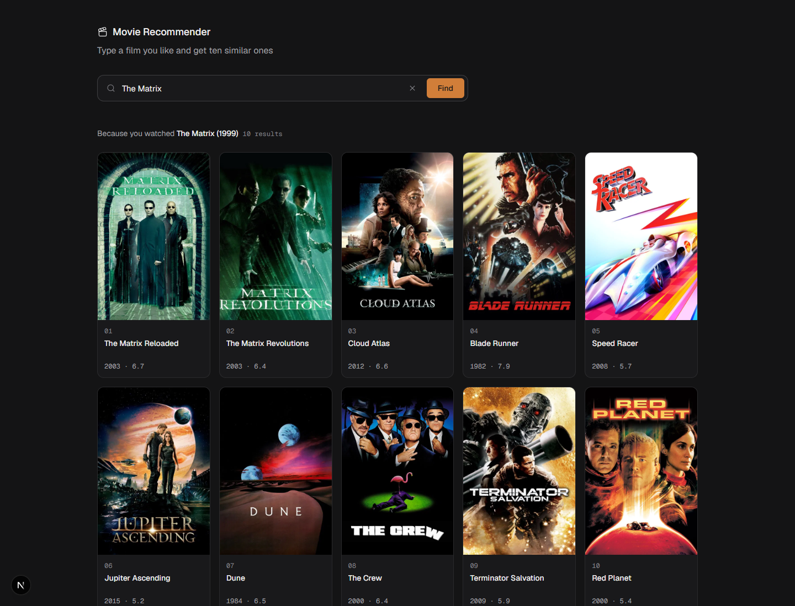

# Filmprint frontend

Next.js 16 (App Router) + React 19 + TypeScript + Tailwind 3 + framer-motion, Geist / Geist Mono. A single page: add films you like, thumb results up or down, filter, and get ten to watch next.



```bash
cp .env.example .env.local   # Windows: copy .env.example .env.local
npm install
npm run dev                  # http://localhost:3000 (webpack)
```

The backend must be running; its URL comes from `NEXT_PUBLIC_API_URL` (default `http://127.0.0.1:8000`) and the backend's CORS list only allows `localhost:3000` / `127.0.0.1:3000` by default.

| File | Role |
|---|---|
| `app/page.tsx` | page state: loading, results, errors, "no exact match" banner, featured-film chips |
| `components/` | `SearchBar` (autocomplete), `ProfileBar` (liked / not-for-me chips, shown in the navbar's "Your taste" menu), `Filters`, `StatsPanel` (always-visible sidebar: your films vs the picks), `MovieCard` (IMDb rating, runtime, IMDb + Letterboxd links, 👍 / 👎 / ✓), `Navbar` (sticky: brand, search, Discover / For you, "Your taste" menu, GitHub link; on a phone the search drops to its own row and the menu spans the screen), `Discover` (sliding poster strip + pick-your-films grid with genre chips; the landing page until you add a film), `LoadingSkeleton` (mirrors the card's height) |
| `lib/stats.ts` | `summarize()` plus runtime / vote-count formatting |
| `lib/profile.ts` | the taste profile and its helpers; saved in `localStorage` and read through `useSyncExternalStore` |
| `lib/title.ts` | turns catalog titles (`Matrix, The (1999)`) into display form (`The Matrix`, year split out) |
| `lib/api.ts` | typed client for `POST /api/v1/recommend/`; `ApiError` + `describeError` turn 404 / 429 / 503 / network failures into distinct messages |

The response's `corrections` list is present only for titles the backend fuzzily changed; the "no exact match" note is driven by it. Keep the featured chips to titles that exist in the catalog (it ends in 2016).

```bash
npm run lint
npx tsc --noEmit
npm run build
```

## Design tokens

Graphite neutrals and one ember accent live as CSS variables in `app/globals.css` and are mapped to Tailwind colors in `tailwind.config.js` (`bg`, `card`, `raised`, `line`, `ink`, `ink-2`, `ink-muted`, `accent`). Surfaces stay neutral so the posters carry the color; no gradients, glows, glass or looping motion. Design pass follows the [unslop](https://github.com/heydamir/unslop) guidelines by Damir Sokolovsky (CC BY 4.0).
